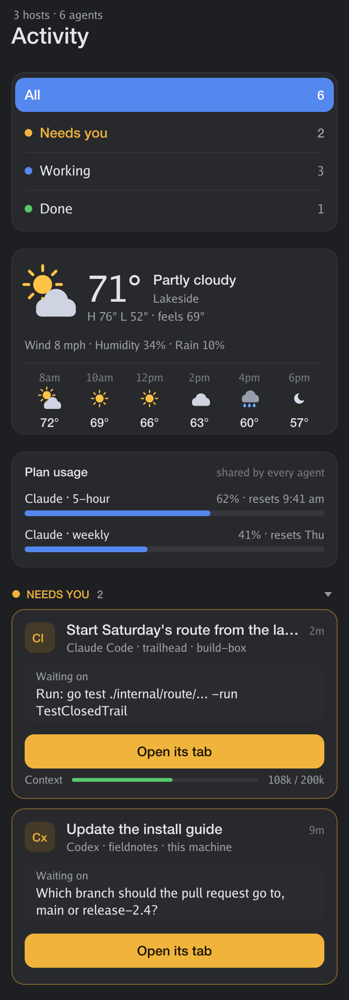
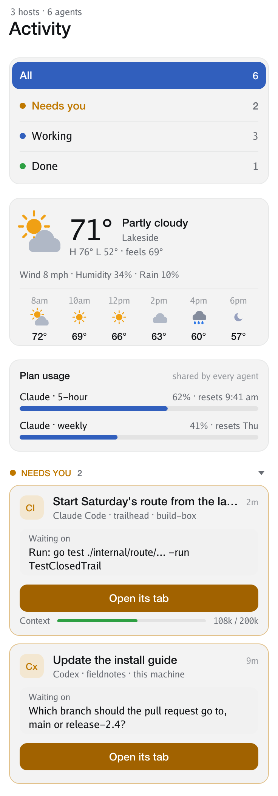
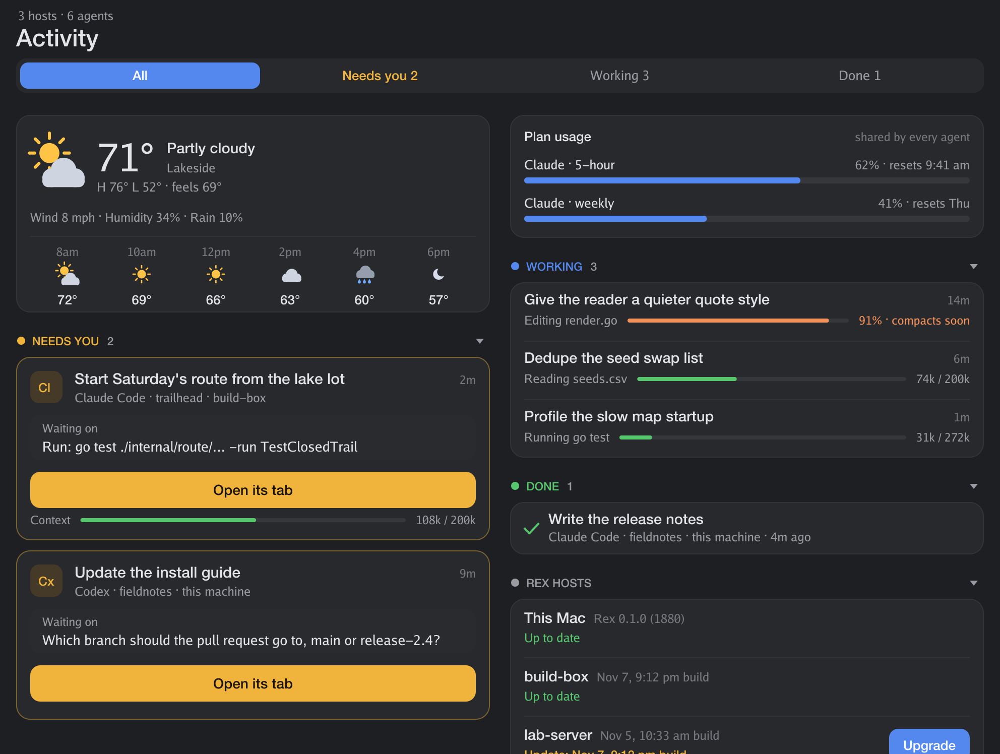

# rex-activity

Every coding agent running in [Rex](https://www.superlogical.com/rex), at a glance, in a terminal pane.

<p align="center"> </p>

It also carries the weather and your Rex hosts' versions, so one pane shows what's going on outside the session you're in.

Agents that need you come first, with what they're waiting on. Next come the ones that are working, each with a meter for how full its context window is. Finished agents come last. Plan usage (Claude's 5-hour and weekly limits) sits at the top, because every agent on the account shares it.

The pane is drawn with the kitty graphics protocol, in the pane's own colours, so it follows your Rex theme in light and dark. Because it's a pane, it also shows up in Rex on your iPad and iPhone, sized to whichever device is looking at it.

In a wide pane, what needs you gets a column of its own:

<p align="center"></p>

rex-activity is an independent project, not made by Superlogical. It only uses Rex's public `rex` command.

## Weather

A card with the conditions, drawn icons, today's high and low, wind, humidity, the chance of rain, and the next few hours. It comes from [Open-Meteo](https://open-meteo.com), which is free and needs no key. A terminal program can't ask the system where it is, so name your place once:

```sh
rex-activity weather "Portland, Oregon"   # a region or country after the comma picks between places
rex-activity weather --units c            # or f; it follows your system otherwise
rex-activity weather --off                # hide the card
```

It refreshes every 15 minutes. Click the card to refresh it now.

## Rex hosts

The Rex version on this machine and on each Rex host (`rex hosts`), and whether a newer one is out. On a Mac, that's the Rex app's build against its own update feed. On a Linux host, it's the `rex` package against Superlogical's apt repository, checked over SSH.

Where a host allows it, **Upgrade** installs the newer package with `sudo apt-get install --only-upgrade rex`, saves your sessions first with `rexurrect` if it's there, and restarts `rex-user.service`. **Restart** does the last step alone. Both show a card listing exactly what they'll do, and nothing runs until you confirm.

While the server is down for a restart, a `rex` command or an app can start a server of its own without Tailscale, and take the socket. That keeps the service, and the host's tailnet name, from coming back. So a restart stops any such server first, and checks the service came up. If a host has dropped off your tailnet for that reason, Activity says so and offers **Restart** to fix it.

For SSH, the host's alias must be its Rex label in lower case, and key login must work without a prompt (`BatchMode=yes`). Upgrade needs passwordless `sudo` there.

## Install

You need Go 1.27 or later and Rex.

```sh
git clone https://github.com/travelingflwr/rex-activity
cd rex-activity
make install            # builds ~/.local/bin/rex-activity
rex-activity show       # opens it in a pane beside yours
```

Or run `rex-activity` in any pane.

## Using it

- **Click** a card, or a row, to jump to that agent's pane.
- **Click a tab** to show only what needs you, what's working, or what's done. Click it again for all. **1** to **4** do the same.
- **Click a section's heading** (Needs you, Working, Done) to fold it away, and again to open it.
- **In a narrow pane** a row of tabs would stop being readable, so the tabs stack one per row at the top of the list, each with its count.
- **Scroll** with the wheel, or **j** and **k**. The title and tabs stay pinned.
- **q** or **Esc** closes it.

## Where the numbers come from

- **Agents and their state:** Rex reports each pane's foreground program, and the status that program reports to Rex: working, waiting on you, or idle, plus a short message. That covers Claude Code and Codex on this machine and on every Rex host you're connected to (`rex hosts`).
- **The task and the context:** For Claude Code on this machine, `~/.claude/sessions/<pid>.json` names the session. Its transcript in `~/.claude/projects` gives your last prompt and how many tokens the last reply used. It's read once, and after that only what's added.
- **Plan usage, and exact context size:** Claude Code passes both to its status line command. To see them in Activity, put `rex-activity statusline` in front of your own status line command in `~/.claude/settings.json`:

  ```json
  "statusLine": {
    "type": "command",
    "command": "rex-activity statusline bash ~/.claude/statusline.sh"
  }
  ```

  It notes the numbers in `~/.local/state/rex-activity/`, then runs your command with the same input, so your status line looks the same. With no status line of your own, use `rex-activity statusline` alone. The plan card appears once Claude Code has reported, and hides when the numbers are more than 12 hours old.

Agents on other hosts show their state and message only, because their transcripts live on those machines.

## Not yet

- Allowing or denying a request from its card. For now the card opens the agent's tab.
- Tasks and context for Codex.
- Tasks and context for agents on other hosts.

## Development

`rex-activity render -o out.png` draws made-up agents to a PNG, with `--theme light`, `--cols` and `--rows` to check other looks and sizes. `kill -USR1` a running pane saves what it shows to `~/.local/state/rex-activity/snapshot-PID.png`.

The drawing code started from [heypad](https://github.com/travelingflwr/heypad). Weather and Rex hosts come from [Rex's Tail](https://github.com/travelingflwr/rex-tail).

## License

MIT. See [LICENSE](LICENSE).
